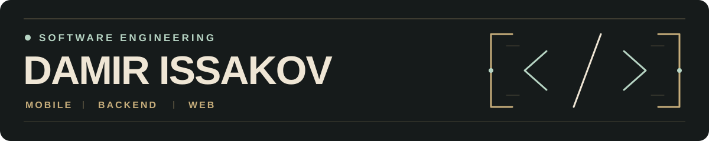

  

  <b>Русский</b> · <a href="README.en.md">English</a> · <a href="https://github.com/drissakov?tab=repositories">Все репозитории</a>

<table>
<tr>
<td width="38%" valign="middle">
  
</td>
<td valign="middle">
  <h2>Привет, я Дамир</h2>
  
Студент <b>Software Engineering</b> в <b>Astana IT University</b>.

  
Создаю Android-приложения, серверные API и веб-интерфейсы. В моих проектах — личные финансы, городское планирование, онлайн-запись, образовательные инструменты и игры.

  
<b>Kotlin · Go · Java · Python · TypeScript</b>

</td>
</tr>
</table>

## Основные проекты

### [MoneyFlow](https://github.com/drissakov/moneyflow)

**Личные финансы · Android + собственный API · MVP**

Приложение для учёта доходов и расходов: несколько счетов, категории и подкатегории, месячная аналитика с диаграммами. Поддерживает 11 валют, оценку общего баланса и конвертацию по курсам Frankfurter.

- Android-клиент с локальным кэшем Room и хранением сессии через Android Keystore.
- API на Go с PostgreSQL, регистрацией, входом и защитой от повторной записи одной операции.
- OpenAPI, миграции, Docker Compose и проверки в GitHub Actions.

**Стек:** `Kotlin` `Jetpack Compose` `Material 3` `Coroutines / StateFlow` `Room` `Retrofit / OkHttp` · `Go` `Gin` `GORM` `PostgreSQL` · `Docker` `Caddy` `GitHub Actions`

### [QueueLess](https://github.com/drissakov/QueueLess)

**Онлайн-запись для малого бизнеса · В разработке**

Основа SaaS для записи на услуги. Сейчас реализованы адаптивный лендинг, endpoint проверки доступности и конфигурация развёртывания на Cloudflare Workers. Подготовлены клиенты базы данных и заготовка Better Auth; авторизация и бронирования — следующие этапы.

**Интерфейс:** `Next.js 16` `React 19` `TypeScript` `Tailwind CSS 4` `shadcn/ui` `Radix`

**Серверная основа и инфраструктура:** `Neon PostgreSQL` `Drizzle ORM` `Better Auth` `Zod` `OpenNext` `Cloudflare Workers`

[Открыть лендинг ↗](https://queueless.queueless.workers.dev)

## Хакатоны

### [Qadam Astana · QBERS](https://github.com/drissakov/hackatonqbersGDG)

**Досуг в Астане · Командный хакатонный MVP**

Сервис помогает выбрать, куда сходить в Астане, с учётом времени, стартовой точки и бюджета. Предлагает до трёх отдельных вариантов с объяснением выбора, ссылками на источники и оценкой длительности посещения.

- Интерфейс на **казахском, русском и английском**, карта, ручной ввод координат и геолокация по разрешению пользователя.
- Повторяемый импорт **985 реальных мест из OpenStreetMap** по семи категориям; лексический и векторный поиск по корпусу с сохранением происхождения данных.
- Отдельный поиск событий; неизвестные цены, часы работы и время в пути явно отмечаются.

**Мой вклад:** frontend на React/TypeScript, локализация kk/ru/en, интеграция API и состояний интерфейса, импорт и проверка качества данных OpenStreetMap, модуль поиска событий и проверки сеансов, тесты интерфейса и API-контрактов.

**Стек проекта:** `React` `TypeScript` `Vite` `i18next` · `Python` `FastAPI` `Pydantic` · `Supabase PostgreSQL` `PostGIS` `pgvector` · `OpenAI Responses` `OpenStreetMap` · `Docker` `GitHub Actions` `Render`

[Открыть демо ↗](https://qadam-astana.onrender.com/)

### [Astana Budget Planner · QBERS](https://github.com/BAITC-Hacks/hack-b53220ee-qbers)

**HackAlem · Astana Innovations Track · Командный хакатонный прототип**

В составе команды **QBERS** разрабатывал инструмент моделирования городского бюджета Астаны. Приложение распределяет средства между пятью направлениями: транспортом, озеленением, социальной сферой, безопасностью и городскими службами.

- Интерактивная карта **2GIS** с районами и инфраструктурой, сценарии добавления остановок и посадки деревьев, сравнение показателей до и после изменений.
- Сохранение бюджетов и сценариев в **PostgreSQL**, серверная валидация и конвертация валют.
- AI-помощник для распределения бюджета через **OpenAI API**, формирование PDF-отчёта и перевод интерфейса через Google Cloud Translation.

**Мой вклад:** страница команды и контактов, общая навигация, ссылки для почтовых сервисов и просмотр портретов участников.

**Стек проекта:** `JavaScript` `React 19` `Vite 8` `CSS` `dnd-kit` · `Python` `Django` `PostgreSQL` · `2GIS MapGL` `OpenAI API` `Google Cloud Translation` `fpdf2` `Docker Compose`

Моделирование сценариев для хакатона; репозиторий архивирован.

## Веб и учебные приложения

### [EsportsHub](https://github.com/drissakov/EsportsHub)

**Киберспортивный сайт · Командный учебный проект**

Адаптивный frontend-прототип из шести страниц: события, команды, игроки, демонстрационные рейтинги и сообщество. Мобильное меню и карусель работают средствами CSS. Мой вклад — **главная страница и раздел событий**.

**Стек:** `HTML5` `CSS3` `Bootstrap 5.3` `Flexbox` `CSS Grid` · Статический сайт без backend.

### [Defense Lab](https://github.com/drissakov/web-midterm-preparation)

**Учебник и практикум по веб-разработке**

Русскоязычный помощник для подготовки к защите веб-проекта: **32 темы, 12 вопросов самопроверки и 36 ответов для защиты**. Интерактивные примеры Flexbox и Grid, разбор EsportsHub, словарь и версия для печати. Работает офлайн; интерактивность построена на CSS.

**Стек:** `HTML5` `CSS3` `Flexbox` `CSS Grid` `:has()` `details / summary` · Без JavaScript и внешних зависимостей.

### [Marine Battle](https://github.com/drissakov/FinalProject)

**Морской бой · Python desktop · Командный учебный проект**

Игра с графическим интерфейсом: против компьютерного соперника со случайным выбором ходов или вдвоём на одном компьютере. Ручная расстановка и поворот кораблей, проверка попаданий и победы, история ходов в JSON и CSV.

Мой вклад — **компьютерный соперник, работа с файлами, модульные тесты, регулярные выражения, декораторы и генераторы, интеграция GUI**.

**Стек:** `Python` `Tkinter` `unittest` `JSON` `CSV`

### [University OOP](https://github.com/drissakov/unioop)

**Система учёта студентов · Учебный проект по ООП**

Модели студентов, преподавателей и групп; поиск, фильтрация и сортировка. Консольная часть поддерживает CRUD через JDBC и PostgreSQL. Веб-часть включает GET/POST API и простой интерфейс; интеграция формы добавления требует доработки.

**Стек:** `Java 17` `Spring Boot 3.3` `Maven` `PostgreSQL` `JDBC` `HTML` `CSS` `JavaScript`

## Технологии в моих проектах

| Направление | Технологии |
| :--- | :--- |
| **Android** | Kotlin, Jetpack Compose, Material 3, Coroutines, Room, Retrofit |
| **Backend** | Go, Gin, GORM; Java, Spring Boot, JDBC; Python, Django, FastAPI, Pydantic |
| **Web** | JavaScript, TypeScript, Next.js, React, Vite, Tailwind CSS, HTML, CSS, Bootstrap |
| **Данные и API** | PostgreSQL, Supabase, PostGIS, pgvector, Neon, Drizzle ORM, REST, OpenAPI, JSON, CSV |
| **Карты и AI** | OpenStreetMap, 2GIS MapGL, OpenAI API / Responses, Google Cloud Translation |
| **Desktop и тесты** | Python, Tkinter, unittest, pytest, Vitest, Testing Library |
| **Инструменты и развёртывание** | Git, Gradle, Maven, Docker, Docker Compose, Caddy, GitHub Actions, Cloudflare Workers, Render |

<b>Остальные репозитории</b>

| Репозиторий | Состояние |
| :--- | :--- |
| [aituoop](https://github.com/drissakov/aituoop) | Пока пустой: исходный код и стек не опубликованы. |
| [universityoop](https://github.com/drissakov/universityoop) | Пока пустой: исходный код и стек не опубликованы. |

  Damir Issakov · <a href="https://github.com/drissakov">@drissakov</a> · Astana IT University

